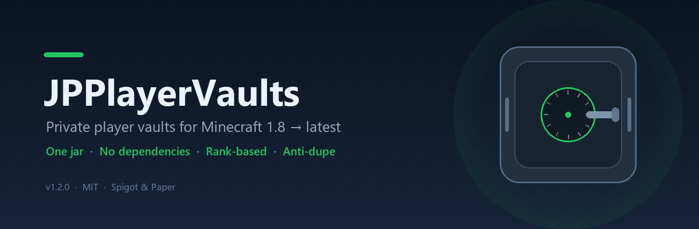
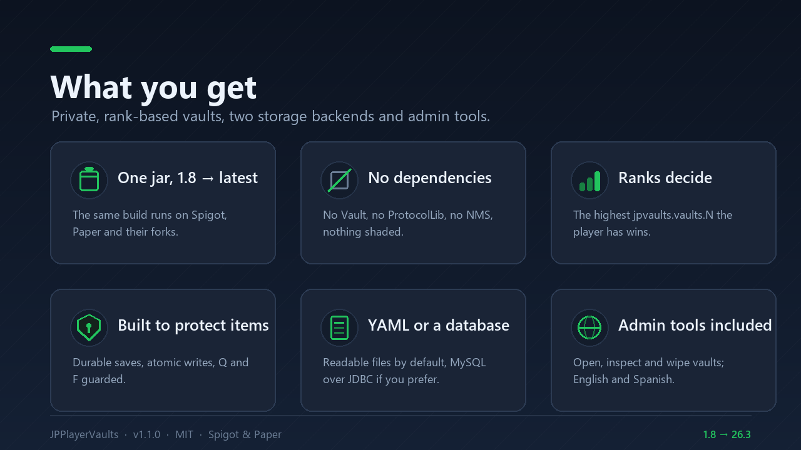
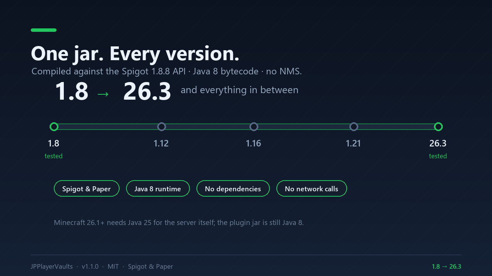
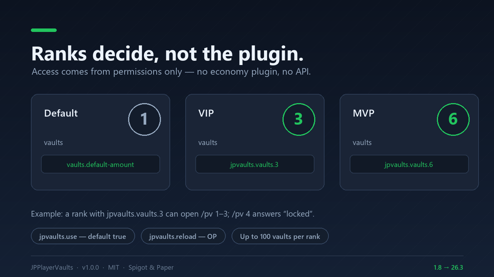
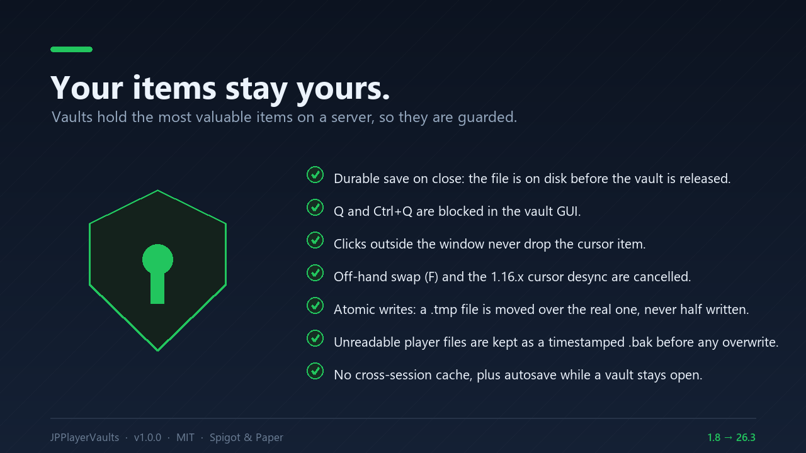
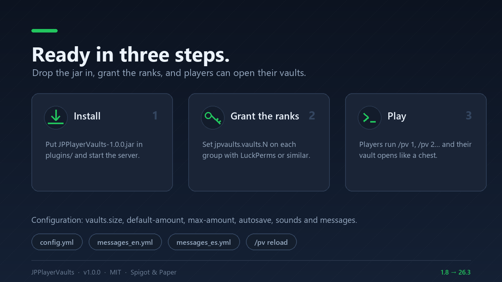
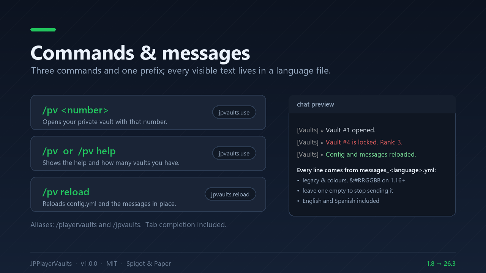

# JPPlayerVaults

[](docs/VERIFICATION.md)
[](LICENSE)
[](https://nameeees.github.io/jpvaults-docs/compatibility/)
[](https://nameeees.github.io/jpvaults-docs/)
[](https://discord.gg/HATd9QgukF)

**Private, permission-based player vaults for Minecraft 1.8 → latest — one jar, no dependencies.**



**Documentation:** <https://nameeees.github.io/jpvaults-docs/> · **Discord:** <https://discord.gg/HATd9QgukF>

JPPlayerVaults gives every player a set of private chests (`/pv 1`, `/pv 2`, …). How many vaults a
player can open is decided by their rank, not by the plugin, and each vault is a normal inventory of
up to **54 slots** (6 rows) — the largest Minecraft allows.

The same jar runs from Minecraft 1.8.8 to the latest release, on Spigot, Paper and forks. It is
built against the Spigot 1.8.8 API, uses no NMS and no third-party libraries, and is free and open
source under the MIT license.

## Table of contents

- [Features](#features)
- [Compatibility](#compatibility)
- [Installation](#installation)
- [Commands](#commands)
- [Permissions](#permissions)
- [Configuration](#configuration)
- [Messages and languages](#messages-and-languages)
- [Storage](#storage)
- [Anti-dupe design](#anti-dupe-design)
- [Building from source](#building-from-source)
- [Project layout](#project-layout)
- [License](#license)

## Features

- `/pv <number>` opens that private vault; `/pv` or `/pv help` shows the help and how many vaults
  the player has.
- **Rank-based vault count**: the plugin grants the highest `jpvaults.vaults.<n>` permission the
  player has. No economy plugin, no Vault, no database required.
- **9 to 54 slots per vault**, configurable (always a multiple of 9).
- Behaves like a real chest: shift-click, hotbar keys, drag and drop, double-click collect.
- **Automatic saving** of open vaults (configurable), plus saving on close, quit and server
  shutdown.
- **Anti-dupe** protections: durable save on close, `Q` and outside clicks blocked, off-hand swap
  guarded, stale GUI views closed on reload, atomic file writes.
- **Every text is configurable** in `messages_<language>.yml` (legacy `&` colors, works on 1.8).
  English and Spanish are bundled; any other language can be added as a file.
- **Single jar**, no NMS, no optional dependencies, no bStats, no update checker, no network
  access.

## Gallery

| | |
| --- | --- |
|  |  |
|  |  |
|  |  |

## Compatibility

| Item | Value |
| --- | --- |
| Built against | Spigot API 1.8.8 (`--release 8`, class file 52) |
| Java runtime | Java 8 or newer (the server itself needs the Java version its Minecraft release requires: 1.21+ → Java 21, 26.x → Java 25) |
| Minecraft | 1.8 → latest (see the test matrix below) |
| Server software | Spigot, Paper and forks that implement the Bukkit API |
| Dependencies | None |
| Tested on | Paper 1.8.8 build 445 (Java 8, integration harness + real 1.8 client) and Paper 26.3 build 205 (Java 25, integration harness) — see [docs/VERIFICATION.md](docs/VERIFICATION.md) |

The plugin only uses API that has existed since 1.8. Where newer versions added features (the
off-hand swap event in 1.9+, the renamed click-type method, the renamed sound constants), it
detects them at runtime and skips the guard on versions that do not have them.

> **Note on the version range**: the jar targets Java 8 bytecode, so it can load on a 1.8 server
> running Java 8 as well as on a 26.x server. Minecraft versions released after 1.21.11 use the
> year-based versioning (26.1, 26.2, 26.3, …); the plugin treats them the same as any other modern
> version. Minecraft 26.1 and newer require Java 25 to run the server itself, which is unrelated to
> the plugin's own Java 8 target.

## Installation

1. Download `JPPlayerVaults-1.0.0.jar` from the
   [releases page](https://github.com/Nameeees/JPPlayerVaults/releases) (or from SpigotMC) and copy
   it into the server's `plugins/` folder.
2. Start the server (or run `/reload confirm`).
3. Grant `jpvaults.vaults.<n>` to your ranks (see below) and adjust
   `plugins/JPPlayerVaults/config.yml` if needed.
4. Optional: set `language: es` in `config.yml` and run `/pv reload` for Spanish messages.

The plugin generates `config.yml` and `messages_en.yml` on first start. `messages_es.yml` (bundled
in the jar) is written to the folder when you set `language: es`.

## Commands

| Command | What it does | Permission |
| --- | --- | --- |
| `/pv <number>` | Opens your vault with that number. | `jpvaults.use` |
| `/pv` or `/pv help` | Shows the help and how many vaults you have. | `jpvaults.use` |
| `/pv reload` | Reloads `config.yml` and the messages in place. | `jpvaults.reload` |

Aliases: `/playervaults`, `/jpvaults`.

## Permissions

| Permission | Description | Default |
| --- | --- | --- |
| `jpvaults.use` | Allows using `/pv` and opening your own vaults. | `true` |
| `jpvaults.vaults.<n>` | The rank gets access to `n` vaults; the highest number the player has is used. | `false` |
| `jpvaults.reload` | Allows `/pv reload`. | OP |

Example with LuckPerms:

```bash
# VIP: 3 vaults
/lp group vip permission set jpvaults.vaults.3 true
# MVP: 6 vaults
/lp group mvp permission set jpvaults.vaults.6 true
```

Players without any `jpvaults.vaults.<n>` permission receive `vaults.default-amount` (1 by
default). If your highest rank needs more than `vaults.max-amount` vaults, raise that value in
`config.yml`. Permission nodes with numbers above the ones listed in `plugin.yml` work too — the
plugin checks every number up to `vaults.max-amount`.

To disable the plugin's command entirely (for example on a lobby server), deny `jpvaults.use` to
the relevant group.

## Configuration

`plugins/JPPlayerVaults/config.yml`:

| Key | Description | Default |
| --- | --- | --- |
| `language` | Message language (`messages_<language>.yml`). Bundled: `en`, `es`. | `en` |
| `vaults.size` | Slots per vault (multiple of 9, 9–54). 54 is the Minecraft maximum. | `54` |
| `vaults.default-amount` | Vaults for players without a rank permission. | `1` |
| `vaults.max-amount` | Highest `jpvaults.vaults.<n>` checked (1–100). | `10` |
| `storage.folder` | Folder inside the plugin folder with the per-player files (restart required to change). | `data` |
| `storage.autosave-seconds` | How often open vaults are saved. `0` disables autosave (close, quit and shutdown still save). | `300` |
| `sounds.enabled` | Interface sounds. | `true` |
| `sounds.volume` | Sound volume (0.0–1.0). | `0.7` |
| `sounds.pitch` | Sound pitch (0.5–2.0). | `1.4` |

Invalid values are clamped and reported in the console instead of breaking the plugin.

## Messages and languages

- All visible text lives in `plugins/JPPlayerVaults/messages_<language>.yml`: prefix, inventory
  title, help, errors.
- Colors use legacy `&` codes, which work on every supported version. `&#RRGGBB` hex colors are
  also accepted and are displayed on 1.16+.
- Leave a message empty (`""`) to stop sending it (for example `command.opened` to keep the chat
  clean).
- An incomplete translation falls back to the bundled English text key by key, and the console
  lists the missing keys once at startup.
- To add a language, copy `messages_en.yml` to `messages_<code>.yml`, translate it and set
  `language: <code>` in `config.yml`. The code must be 2–16 characters (`a-z`, `0-9`, `_`, `-`).

The inventory title is capped at 32 visible characters for compatibility with 1.8–1.12 clients; if
you configure a longer title it is shortened and a warning is logged.

## Storage

- One readable file per player: `plugins/JPPlayerVaults/data/<uuid>.yml`.
- Format: `vaults.<number>.items.<slot>: <Bukkit item>`, plus the last known player name so
  administrators can identify the file.
- Data is read from disk when a vault is opened and dropped when the player quits, so a restart
  always starts from the real file.
- Lowering `vaults.size` temporarily **does not delete anything**: items in hidden rows are kept in
  the file and reappear when the size is raised again.
- Bukkit converts item material names that were renamed in 1.13+ when loading, so data survives
  Minecraft upgrades.
- If a file cannot be read (corrupted or hand-edited YAML), the plugin keeps a timestamped `.bak`
  copy before it can be overwritten, and an item that fails to deserialize does not prevent the
  rest of the vault from loading.

## Anti-dupe design

Vaults usually hold a server's most valuable items, so the plugin is designed not to duplicate or
lose them:

- **Durable save on close**: closing a vault (or quitting) waits until the file is on disk before
  returning control. If the server dies right after, the content is already safe — there is no
  rollback to duplicate.
- **`Q` blocked**: while a vault is open, `Q`/`Ctrl+Q` actions in the GUI are cancelled, with a
  sound and no effect.
- **Clicks outside the window**: they do not drop the cursor item into the void (a vanilla chest
  would).
- **`F` key**: the off-hand swap (1.9+) is cancelled while a vault is open; with an item on the
  cursor the GUI click is also cancelled (the classic 1.16.x desync vector).
- **No zombie GUIs**: reloading the plugin closes open vaults, and on enable any surviving vault
  view is closed. An old inventory cannot be emptied twice.
- **Switching vaults without loss**: going from `/pv 1` to `/pv 2` saves the first one even if the
  close event timing differs between versions.
- **Atomic writes**: every save writes a `.tmp` file and moves it over the real file, so a crash
  mid-write cannot leave a half-written file.
- **No cross-session cache**: data is read from disk on open and discarded on quit.
- **Autosave** every `storage.autosave-seconds`, which limits the loss if the server crashes while
  a vault is open.

Known limits, stated plainly:

- If the process is killed **while** a player has a vault open, the last save is restored (hence
  autosave). Saving on every click would tax the whole server.
- Do not share one `data/` folder between several running servers: the plugin does not sync
  servers live (opening reads the real file and quitting drops the cache, but two active servers
  with the same player are not a supported scenario).
- Closing a vault blocks the calling thread until the write completes (bounded to 5 seconds). This
  is deliberate: it is what makes the durable close guarantee possible.

## Building from source

Requirements: JDK 17 or newer (JDK 21 recommended) and Maven 3.8+. The build targets Java 8
bytecode so the resulting jar runs on old servers.

```bash
mvn clean package
```

The jar is written to `target/JPPlayerVaults-<version>.jar`. The build is reproducible: the same
source produces the same SHA-256 hash.

To publish a new version, change `<version>` in `pom.xml`; `plugin.yml` reads it from there
automatically.

## Project layout

```
src/main/java/me/jp/jpvaults/
├── JPPlayerVaults.java          # lifecycle, config, sounds, off-hand guard
├── command/PlayerVaultCommand.java
├── listener/VaultListener.java  # close, quit, Q/F protection
├── manager/                     # MessageManager (languages) and VaultManager (core)
├── menu/VaultHolder.java        # identifies the open inventory
├── model/PlayerVaultData.java   # in-memory data (54 slots per vault)
├── storage/                     # VaultStorage interface + YAML implementation
└── util/                        # Text (colors/truncation) and UiSound (version-safe sounds)

src/main/resources/
├── plugin.yml                   # commands and permissions
├── config.yml
├── messages_en.yml
└── messages_es.yml
```

## Support

- **Documentation site:** <https://nameeees.github.io/jpvaults-docs/> — installation, configuration,
  permissions, data safety, FAQ and changelog.
- **Community Discord:** <https://discord.gg/HATd9QgukF> — support, bug reports and release updates.
- **Bug reports:** open an issue on this repository or ask in the Discord. Please include the server
  version, the plugin version, `config.yml` and the relevant console log.
- **SpigotMC:** the resource page is the primary download; this repository is the source.

## License

MIT — see [LICENSE](LICENSE). You may use, modify and redistribute the plugin, including on
commercial servers, as long as the copyright notice is kept.

---

*Documentación en español: [docs/README.es.md](docs/README.es.md).*
