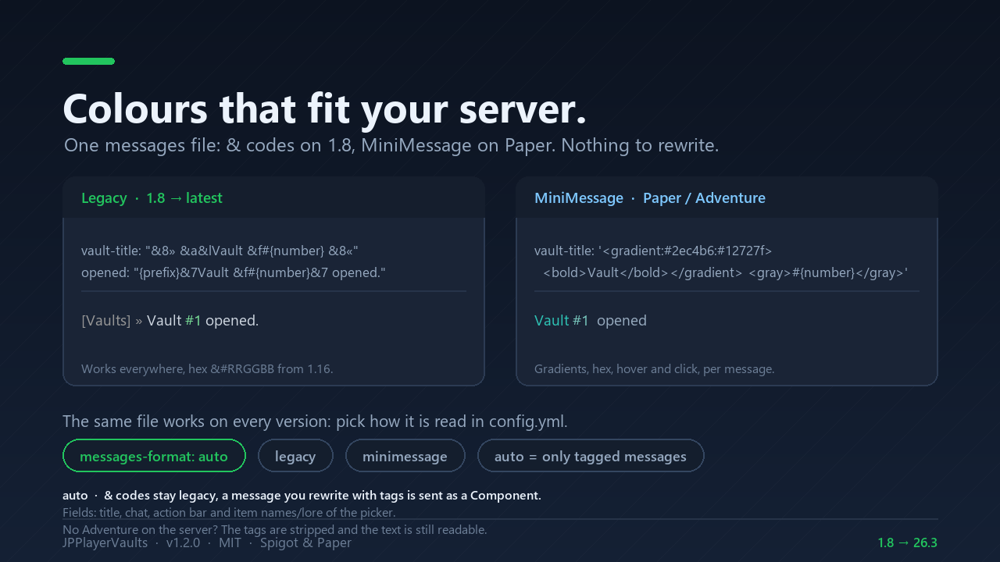

# JPPlayerVaults

[](docs/VERIFICATION.md)
[](LICENSE)
[](https://nameeees.github.io/jpvaults-docs/compatibility/)
[](https://nameeees.github.io/jpvaults-docs/)
[](https://discord.gg/VQSvfQw8v8)

**Private, permission-based player vaults for Minecraft 1.8 → latest — one jar, no dependencies.**


**Documentation:** <https://nameeees.github.io/jpvaults-docs/> · **Discord:** <https://discord.gg/VQSvfQw8v8>

JPPlayerVaults gives every player a set of private chests (`/pv 1`, `/pv 2`, …). How many vaults a
player can open is decided by their rank, not by the plugin, and each vault is a normal inventory of
up to **54 slots** (6 rows) — the largest Minecraft allows.

The same jar runs from Minecraft 1.8.8 to the latest release, on Spigot, Paper and forks. It is
built against the Spigot 1.8.8 API, uses no NMS and no third-party libraries, and is free and open
source under the MIT license.

## Table of contents

- [Features](#features)
- [Compatibility](#compatibility)
- [Installation](#installation)
- [Commands](#commands)
- [Administration](#administration)
- [Permissions](#permissions)
- [Configuration](#configuration)
- [Messages and languages](#messages-and-languages)
- [Storage backends](#storage-backends)
- [Anti-dupe design](#anti-dupe-design)
- [Building from source](#building-from-source)
- [Using this repository as a template](#using-this-repository-as-a-template)
- [Project layout](#project-layout)
- [License](#license)

## Features

- `/pv` opens a **vault picker**: a menu with one icon per vault showing how many items each one
  holds. `/pv <number>` opens that vault directly; `/pv help` shows the text help
  (`vaults.picker: false` brings back the old behaviour).
- **Rank-based vault count**: the plugin grants the highest `jpvaults.vaults.<n>` permission the
  player has. No economy plugin and no Vault required.
- **9 to 54 slots per vault**, configurable (always a multiple of 9).
- Behaves like a real chest: shift-click, hotbar keys, drag and drop, double-click collect.
- **Automatic saving** of open vaults (configurable), plus saving on close, quit and server
  shutdown.
- **Anti-dupe** protections: durable save on close, `Q` and outside clicks blocked, off-hand swap
  guarded, stale GUI views closed on reload, atomic file writes.
- **Two storage backends**: readable YAML files (default) or a database over JDBC
  (`storage.type: mysql`), with `/pv admin migrate` to move between them.
- **Items stored the way the server recommends**: on Paper 1.20.5+ vaults are saved as NBT
  (`ItemStack.serializeItemsAsBytes`), which Paper documents as safer for data migrations than
  Bukkit's serialization; anywhere else the Bukkit format is used. Both are read back transparently
  and data saved by 1.0.0/1.1.0 keeps loading (`storage.item-format`).
- **Administrator tools**: open another player's vault (online or offline), inspect a player or the
  plugin, delete a single vault and migrate the storage.
- **Every text is configurable** in `messages_<language>.yml`. Legacy `&` colours work on every
  version, and on Paper/Adventure the same file accepts **MiniMessage** (gradients, hex, hover,
  click) per message — `messages-format: legacy | minimessage | auto`. English and Spanish are
  bundled; any other language can be added as a file.
- **Single jar**, no NMS, no shaded libraries, no bStats, no update checker, no network access of
  its own.

## Gallery

| | |
| --- | --- |
|  |  |
|  |  |
|  |  |
|  | |

## Compatibility

| Item | Value |
| --- | --- |
| Built against | Spigot API 1.8.8 (`--release 8`, class file 52) |
| Java runtime | Java 8 or newer (the server itself needs the Java version its Minecraft release requires: 1.21+ → Java 21, 26.x → Java 25) |
| Minecraft | 1.8 → latest (see the test matrix below) |
| Server software | Spigot, Paper and forks that implement the Bukkit API |
| Dependencies | None |
| Tested on | Paper 1.8.8 build 445 (Java 8, integration harness + real 1.8 client) and Paper 26.3 build 205 (Java 25, integration harness) — see [docs/VERIFICATION.md](docs/VERIFICATION.md) |

The plugin only uses API that has existed since 1.8. Where newer versions added features (the
off-hand swap event in 1.9+, the renamed click-type method, the renamed sound constants), it
detects them at runtime and skips the guard on versions that do not have them.

> **Note on the version range**: the jar targets Java 8 bytecode, so it can load on a 1.8 server
> running Java 8 as well as on a 26.x server. Minecraft versions released after 1.21.11 use the
> year-based versioning (26.1, 26.2, 26.3, …); the plugin treats them the same as any other modern
> version. Minecraft 26.1 and newer require Java 25 to run the server itself, which is unrelated to
> the plugin's own Java 8 target.

## Installation

1. Download `JPPlayerVaults-1.2.0.jar` from the
   [releases page](https://github.com/Nameeees/JPPlayerVaults/releases) (or from SpigotMC) and copy
   it into the server's `plugins/` folder.
2. Start the server (or run `/reload confirm`).
3. Grant `jpvaults.vaults.<n>` to your ranks (see below) and adjust
   `plugins/JPPlayerVaults/config.yml` if needed.
4. Optional: set `language: es` in `config.yml` and run `/pv reload` for Spanish messages.

The plugin generates `config.yml` and `messages_en.yml` on first start. `messages_es.yml` (bundled
in the jar) is written to the folder when you set `language: es`.

## Commands

| Command | What it does | Permission |
| --- | --- | --- |
| `/pv` | Opens the vault picker: one icon per vault, with how many items each one holds. | `jpvaults.use` |
| `/pv <number>` | Opens your vault with that number directly. | `jpvaults.use` |
| `/pv help` | Shows the help and how many vaults you have. | `jpvaults.use` |
| `/pv reload` | Reloads `config.yml` and the messages in place. | `jpvaults.reload` |
| `/pv admin ...` | Administrator tools; see [Administration](#administration). | `jpvaults.admin` |

Aliases: `/playervaults`, `/jpvaults`.

## Administration

Administrator commands live under `/pv admin` and need `jpvaults.admin` (OP by default). The target
can be the name of someone who has played on the server, or a UUID — handy for accounts that are no
longer in the cache; copy it from the logs or from a data file.

| Command | What it does |
| --- | --- |
| `/pv admin open <player\|uuid> <number>` | Opens that player's vault, online or offline. You can edit it; the changes are saved to the owner's data. |
| `/pv admin info` | Storage in use, players with data, vault size, default and maximum amounts and autosave. |
| `/pv admin info <player\|uuid>` | UUID, online state, vaults with items, stored items, rank and who has that vault open right now. |
| `/pv admin delete <player\|uuid> <number> confirm` | Wipes one vault. The `confirm` word is required on purpose. |
| `/pv admin migrate [force]` | Copies the YAML files into the database. Without `force` it skips players already stored. |

Notes:

- A vault can only be open for one person at a time: if the owner has it open, `/pv admin open`
  refuses and says who is using it, and `/pv admin delete` refuses to delete an open vault.
- What an administrator opens or deletes is written to the console log.
- `/pv admin migrate` runs in small batches on the server thread (5 players per tick) and the
  database writes happen asynchronously, so it cannot freeze the server. The YAML files are never
  deleted: remove them yourself once you are happy with the database.

## Permissions

| Permission | Description | Default |
| --- | --- | --- |
| `jpvaults.use` | Allows using `/pv` and opening your own vaults. | `true` |
| `jpvaults.vaults.<n>` | The rank gets access to `n` vaults; the highest number the player has is used. | `false` |
| `jpvaults.reload` | Allows `/pv reload`. | OP |
| `jpvaults.admin` | Allows the `/pv admin` subcommands (open, info, delete, migrate). | OP |

Example with LuckPerms:

```bash
# VIP: 3 vaults
/lp group vip permission set jpvaults.vaults.3 true
# MVP: 6 vaults
/lp group mvp permission set jpvaults.vaults.6 true
```

Players without any `jpvaults.vaults.<n>` permission receive `vaults.default-amount` (1 by
default). If your highest rank needs more than `vaults.max-amount` vaults, raise that value in
`config.yml`. Permission nodes with numbers above the ones listed in `plugin.yml` work too — the
plugin checks every number up to `vaults.max-amount`.

To disable the plugin's command entirely (for example on a lobby server), deny `jpvaults.use` to
the relevant group.

## Configuration

`plugins/JPPlayerVaults/config.yml`:

| Key | Description | Default |
| --- | --- | --- |
| `language` | Message language (`messages_<language>.yml`). Bundled: `en`, `es`. | `en` |
| `messages-format` | How the messages are read: `legacy` (`&`), `minimessage` (tags, needs Paper/Adventure) or `auto` (legacy, but a message written with tags is sent as a Component). | `auto` |
| `vaults.size` | Slots per vault (multiple of 9, 9–54). 54 is the Minecraft maximum. | `54` |
| `vaults.default-amount` | Vaults for players without a rank permission. | `1` |
| `vaults.max-amount` | Highest `jpvaults.vaults.<n>` checked (1–100). | `10` |
| `vaults.picker` | `/pv` with no arguments opens the vault menu; `false` shows the help text instead. | `true` |
| `vaults.title-max-length` | Longest inventory title in visible characters; `0` = no limit (only for servers whose clients are all modern). | `32` |
| `storage.type` | `yaml` (one file per player) or `mysql` (any database over JDBC). Requires a restart. | `yaml` |
| `storage.folder` | Folder inside the plugin folder with the per-player files. Also the source of `/pv admin migrate`. | `data` |
| `storage.autosave-seconds` | How often open vaults are saved. `0` disables autosave (close, quit and shutdown still save). | `300` |
| `storage.item-format` | SQL backend: `auto` (NBT where the server has it), `nbt` or `bukkit`. | `auto` |
| `storage.yaml-format` | YAML backend: `readable` (one item per slot, hand-editable) or `nbt` (each vault as Base64 NBT). | `readable` |
| `storage.mysql.*` | Database connection: `host`, `port`, `database`, `username`, `password`, `table-prefix`, `properties`, `jdbc-url`, `driver-class`, `driver-jar`, `pool-size`, `connection-timeout-ms`. | — |
| `sounds.enabled` | Interface sounds. | `true` |
| `sounds.volume` | Sound volume (0.0–1.0). | `0.7` |
| `sounds.pitch` | Sound pitch (0.5–2.0). | `1.4` |

Invalid values are clamped and reported in the console instead of breaking the plugin.

## Messages and languages

- All visible text lives in `plugins/JPPlayerVaults/messages_<language>.yml`: prefix, inventory
  title, help, errors, and the vault picker (title, item name and lore).
- Colors use legacy `&` codes, which work on every supported version. `&#RRGGBB` hex colors are
  also accepted and are displayed on 1.16+.
- **Modern colours**: on Paper (Adventure) a message written with MiniMessage tags is sent as a
  Component — gradients, hex, hover and click included:

  ```yaml
  vault-title: '<gradient:#2ec4b6:#12727f><bold>Vault</bold></gradient> <gray>#{number}</gray>'
  command.help:
    - '<gray>Open <click:run_command:''/pv 1''><aqua>/pv 1</aqua></click></gray>'
  ```

  With `messages-format: auto` (default) a message that uses `&` stays legacy, so nothing changes
  until you rewrite a specific message. With `minimessage`, **every** message is parsed as
  MiniMessage. On a server without Adventure the tags are stripped so the text stays readable, and
  the console says so once. Details: [docs/MODERN_FEATURES.md](docs/MODERN_FEATURES.md).
- Leave a message empty (`""`) to stop sending it (for example `command.opened` to keep the chat
  clean).
- An incomplete translation falls back to the bundled English text key by key, and the console
  lists the missing keys once at startup.
- To add a language, copy `messages_en.yml` to `messages_<code>.yml`, translate it and set
  `language: <code>` in `config.yml`. The code must be 2–16 characters (`a-z`, `0-9`, `_`, `-`).

The inventory title is capped at `vaults.title-max-length` visible characters (32 by default) for
compatibility with 1.8–1.12 clients; if you configure a longer one it is shortened and a warning is
logged. On servers where the title is built as a Component you can set the limit to `0` to use it
as-is.

## Storage backends

### YAML (default)

- One readable file per player: `plugins/JPPlayerVaults/data/<uuid>.yml`.
- Format: `vaults.<number>.items.<slot>: <Bukkit item>`, plus the last known player name so
  administrators can identify the file.
- Data is read from disk when a vault is opened and dropped when the player quits, so a restart
  always starts from the real file.
- Lowering `vaults.size` temporarily **does not delete anything**: items in hidden rows are kept in
  the file and reappear when the size is raised again.
- Bukkit converts item material names that were renamed in 1.13+ when loading, so data survives
  Minecraft upgrades.
- If a file cannot be read (corrupted or hand-edited YAML), the plugin keeps a timestamped `.bak`
  copy and refuses to open the vault until an administrator restores it — showing an empty vault
  would let the next save overwrite the real items. A single item that fails to deserialize does not
  prevent the rest of the vault from loading.

### Database over JDBC (MySQL / MariaDB)

```yaml
storage:
  type: mysql
  mysql:
    host: '127.0.0.1'
    port: 3306
    database: 'jpvaults'
    username: 'root'
    password: ''
    table-prefix: 'jpvaults_'
```

- Tables are created on startup: `<prefix>players` (`uuid`, `last_name`, `updated_at`) and
  `<prefix>vaults` (`uuid`, `vault`, `data`, `updated_at`). One row per vault, written inside a
  transaction (delete + insert), so a failure halfway cannot leave a vault half saved.
- The JDBC driver comes from the server: Spigot and Paper ship MySQL Connector/J. The plugin tries
  `com.mysql.cj.jdbc.Driver`, `com.mysql.jdbc.Driver` and then `org.mariadb.jdbc.Driver`; point
  `storage.mysql.driver-class` at another one and use `jdbc-url` for another engine.
- If the server does not ship a driver, drop the driver `.jar` into `plugins/JPPlayerVaults/lib/`
  (loaded with its own class loader) or point `storage.mysql.driver-jar` at it. Paper can also
  download it for you if you uncomment the `libraries:` block in `plugin.yml` — it is commented out
  because that makes every server start need internet.
- No pool library is bundled: the plugin keeps a few connections of its own and reuses them.
- If the database cannot be reached at startup, the plugin logs the error and **keeps working with
  YAML** rather than leaving the server without vaults. Fix the settings, restart, and run
  `/pv admin migrate` to copy the YAML data into the database.
- Reads happen on the server thread when a vault opens; writes happen on a single plugin thread, in
  order, and closing a vault waits (bounded to 5 seconds) for its transaction.

### How the items are stored

Each vault is a byte blob in the database and either readable slots or one Base64 blob in YAML, and
the format is recorded inside the data itself:

| Format | When it is used | Why |
| --- | --- | --- |
| **NBT** (`serializeItemsAsBytes`) | Paper 1.20.5+ with `storage.item-format: auto` or `nbt` | Paper's own javadoc: *"NBT is safer for data migrations as it will use the built-in data converter instead of bukkits dangerous serialization system"*. It also keeps slot order and gaps by design. |
| **Bukkit** (object stream / YAML maps) | Spigot, older versions, or `item-format: bukkit` | Works on every version, and it is what 1.0.0–1.1.0 wrote, so existing data keeps loading either way. |

- Every blob starts with a format byte and blobs written before 1.2.0 (no header) are still
  detected, so **there is nothing to migrate** when upgrading.
- A vault stored as NBT can only be read by a server that has that API: before moving a world from
  Paper to Spigot, set `item-format: bukkit` on Paper and let the vaults be saved again.
- `storage.yaml-format: nbt` does the same for the YAML backend, storing each vault as Base64 NBT
  instead of hand-editable slots (readable stays the default).

### Moving between backends

`/pv admin migrate` copies every YAML file into the active database:

- Without arguments it skips players that already have rows; `force` overwrites them.
- Progress and a summary go to whoever ran it and to the console.
- The YAML files are left untouched, so they stay as a backup.

The opposite direction is **not** automated: if you switch `type` back to `yaml`, the plugin starts
from the files it finds, and anything written to the database meanwhile would be missing. Keep the
YAML folder (or a database dump) until you are sure, and prefer migrating YAML → database rather
than the other way round.

## Anti-dupe design

Vaults usually hold a server's most valuable items, so the plugin is designed not to duplicate or
lose them:

- **Durable save on close**: closing a vault (or quitting) waits until the file is on disk before
  returning control. If the server dies right after, the content is already safe — there is no
  rollback to duplicate.
- **`Q` blocked**: while a vault is open, `Q`/`Ctrl+Q` actions in the GUI are cancelled, with a
  sound and no effect.
- **Clicks outside the window**: they do not drop the cursor item into the void (a vanilla chest
  would).
- **`F` key**: the off-hand swap (1.9+) is cancelled while a vault is open; with an item on the
  cursor the GUI click is also cancelled (the classic 1.16.x desync vector).
- **No zombie GUIs**: reloading the plugin closes open vaults, and on enable any surviving vault
  view is closed. An old inventory cannot be emptied twice.
- **Switching vaults without loss**: going from `/pv 1` to `/pv 2` saves the first one even if the
  close event timing differs between versions.
- **Atomic writes**: every save writes a `.tmp` file and moves it over the real file, so a crash
  mid-write cannot leave a half-written file.
- **No cross-session cache**: data is read from disk on open and discarded on quit.
- **Autosave** every `storage.autosave-seconds`, which limits the loss if the server crashes while
  a vault is open.

Known limits, stated plainly:

- If the process is killed **while** a player has a vault open, the last save is restored (hence
  autosave). Saving on every click would tax the whole server.
- Do not share one `data/` folder between several running servers: the plugin does not sync
  servers live (opening reads the real file and quitting drops the cache, but two active servers
  with the same player are not a supported scenario).
- Closing a vault blocks the calling thread until the write completes (bounded to 5 seconds). This
  is deliberate: it is what makes the durable close guarantee possible.

## Building from source

Requirements: JDK 17 or newer (JDK 21 recommended) and Maven 3.8+. The build targets Java 8
bytecode so the resulting jar runs on old servers.

```bash
mvn clean package
```

The jar is written to `target/JPPlayerVaults-<version>.jar`. The build is reproducible: the same
source produces the same SHA-256 hash.

To publish a new version, change `<version>` in `pom.xml`; `plugin.yml` reads it from there
automatically.

## Project layout

```
src/main/java/me/jp/jpvaults/
├── JPPlayerVaults.java          # lifecycle, config, storage selection, sounds, off-hand guard
├── command/PlayerVaultCommand.java
├── listener/VaultListener.java  # close, quit, Q/F protection
├── manager/                     # MessageManager, VaultManager (core) and StorageMigration
├── menu/VaultHolder.java        # identifies the open inventory (own or admin view)
├── model/PlayerVaultData.java   # in-memory data (54 slots per vault)
├── storage/                     # VaultStorage + YAML and JDBC backends, codec and settings
└── util/                        # Text (colors/truncation) and UiSound (version-safe sounds)

src/main/resources/
├── plugin.yml                   # commands and permissions
├── config.yml
├── messages_en.yml
└── messages_es.yml
```

## Using this repository as a template

JPPlayerVaults doubles as the reference setup for the next plugins: the same project layout, CI
build, documentation site, test harness and SpigotMC submission pack.

- The repository is marked as a GitHub **template**, so *Use this template → Create a new
  repository* gives you a clean copy in one click.
- **The step-by-step playbook is [docs/TEMPLATE.md](docs/TEMPLATE.md)**: what to rename file by
  file, the consistency check, the exact GitHub API/CLI commands to create the repository, the docs
  site and the release, the SpigotMC rules that shape the description, and the traps already paid
  for (the `bungeecord-chat` snapshot, the Maven descriptor changing the jar hash, the 1.8 API that
  cannot proxy `Player`, `mkdocs build --strict` errors, and more).
- The **[modern-version audit](docs/MODERN_FEATURES.md)** lists what the newest APIs (26.3) offer
  that this plugin does not use yet — NBT item storage for safer Minecraft upgrades, cached offline
  lookups, Adventure components, native dialogs, Folia and Paper's `libraries:` — with the verified
  API facts behind each item, what not to do, and a recommended order.

## Support

- **Documentation site:** <https://nameeees.github.io/jpvaults-docs/> — installation, configuration,
  permissions, data safety, FAQ and changelog.
- **Community Discord:** <https://discord.gg/VQSvfQw8v8> — support, bug reports and release updates.
- **Bug reports:** open an issue on this repository or ask in the Discord. Please include the server
  version, the plugin version, `config.yml` and the relevant console log.
- **SpigotMC:** the resource page is the primary download; this repository is the source.

## License

MIT — see [LICENSE](LICENSE). You may use, modify and redistribute the plugin, including on
commercial servers, as long as the copyright notice is kept.

---

*Documentación en español: [docs/README.es.md](docs/README.es.md).*
